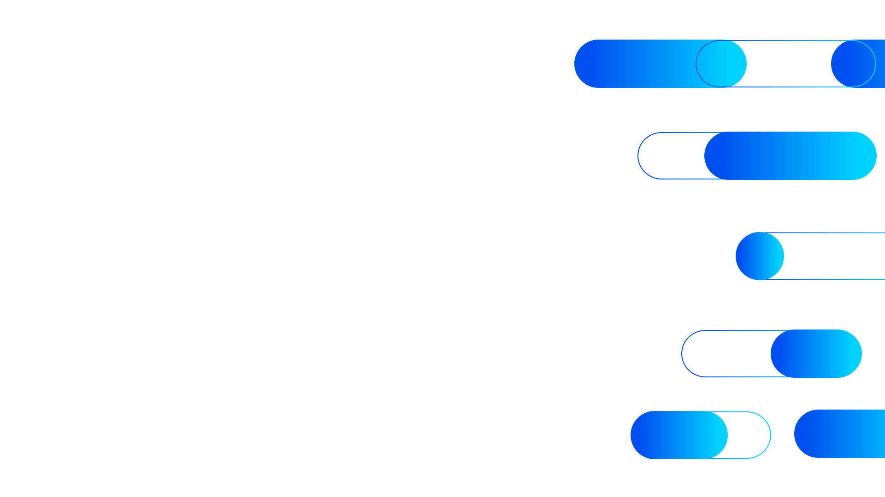

# the brand — Brand Rules

> One rule per topic. Each rule is numeric and reproducible. **The format is fixed**:
> OBRIGATÓRIO · PROIBIDO · VALORES EXATOS · MOTIVO · EXEMPLO CORRETO · EXEMPLO ERRADO.
>
> When a topic is silent on a question, the rule **defaults to "use the closest token and ask the user."**

---

## 1. Logo

**OBRIGATÓRIO**
- Use the official SVG files in `assets/`. Positive: `logo.svg`. Negative (reversed): `logo-white.svg`. **Choose by background luminance**, not by aesthetic preference.
- Place the logo in the **top-left** of slides / pages by default. Acceptable alternates: top-center for square posts, centered on splash/sign-in.
- Maintain **clear space ≥ 1× the logo height** on all four sides. Nothing — text, icons, pills, image edges — may enter this zone.
- Minimum digital size: **height ≥ 24px** (28px preferred). Minimum print size: **height ≥ 10mm**.
- Preserve aspect ratio. Resize via `height: <px>; width: auto;` (or set width and let height follow).
- On photography or family-gradient backgrounds, always use the reversed (white) wordmark — even if a contrast checker passes the positive one.

**PROIBIDO**
- Recoloring the wordmark, the bars, or any stroke
- Rotating, italicizing, stretching, condensing, outlining, drop-shadowing the logo
- Placing the positive logo on dark or saturated-color backgrounds
- Adding effects (glow, emboss, gradient overlay) to the logo
- Placing other graphics inside the clear-space zone
- Reconstructing the wordmark by hand — always use the SVG file

**VALORES EXATOS**
- Wordmark fill (positive): `#0050F0`
- Bars fill (both variants): `#00D2FF`
- Wordmark fill (reversed): `#FFFFFF`
- Min height digital: `24px`
- Min height print: `10mm`
- Clear-space on every side: `≥ 1× logo height`
- Default top-left offset on 1920×1080 slides: `x: 135px, y: 130px`

**MOTIVO**
The logo is the brand's most-protected asset. Any visual deviation reads as "this is not official."

**EXEMPLO CORRETO**
```html

```

**EXEMPLO ERRADO**
```html
<!-- Recolored, stretched, on a white background that doesn't match the logo edge -->

```

---

## 2. Cores institucionais (Deep vs Bright)

**OBRIGATÓRIO**
- **Blue always leads.** Every layout starts from Brand Deep `#0050f0` as the dominant institutional color. Brand Bright `#00d2ff` is the accent.
- The default surface decoration (pills, lines, ring, accents) uses Deep + Bright. Family colors do not appear unless the content is *about* that family.
- Dominance ratio across a single layout: **Deep ≥ 60% of brand-color area · Bright ≤ 30% · all other accents ≤ 10%**.

**PROIBIDO**
- Using Brand Bright `#00d2ff` as the primary background of a full surface (it's an accent — pair it inside a gradient with Deep)
- Using family colors (`--credit-*`, `--supply-*`, `--lead-*`, `--cred-*`) as page background or generic accent — they only flag a Category
- Pairing Deep and Bright from two different families in the same icon, pill, or composition
- Using black (`#000`) or near-black (`#111`, `#222`) for body copy — text colors are warm gray (`#4b4b4b` titles, `#7c7c7c` body)

**VALORES EXATOS**
- `--brand-deep:   #0050f0` (PMS 2935 C · RGB 0/80/240 · CMYK 100/75/0/0)
- `--brand-bright: #00d2ff` (PMS 297 C · RGB 0/210/255 · CMYK 60/0/0/0)
- `--brand-title:  #4b4b4b` (PMS 7540 C)
- `--brand-body:   #7c7c7c` (PMS 877 C)

**MOTIVO**
Deep is the "backbone of every layout." Family colors used decoratively break the categorical grammar of the brand.

**EXEMPLO CORRETO**
```html
<button style="background: var(--brand-deep); color: #fff; border-radius: var(--radius-pill); padding: 12px 24px;">
  Request a demo
</button>
```

**EXEMPLO ERRADO**
```html
<!-- Family green as a decorative accent in a non-credit context -->
<div style="border-left: 4px solid #00cc00; padding-left: 12px;">Generic feature</div>
```

---

## 3. Gradiente

**OBRIGATÓRIO**
- Use the named token `--brand-gradient` (defined as `linear-gradient(90deg, #0050f0 10%, #00d2ff 90%)`) for every D→B gradient.
- For hero / background variants, use `--brand-gradient-115` (115° angle). Permitted angles: **90°** (text fills, CTAs, footer mega-band) and **115°** (hero backgrounds).
- Family gradients use the same `10% / 90%` stop rule with the family's Deep → Bright pair.
- For text fills, wrap with `.brand-text-gradient`.

**PROIBIDO**
- Stops at `0% / 100%` — this is the most common generator error and visually flattens the gradient
- Three-color or rainbow gradients
- Vertical (180°) or diagonal-other-than-115° gradients
- Mixing two family gradients in one element

**VALORES EXATOS**
- D→B gradient (canonical): `linear-gradient(90deg, #0050f0 10%, #00d2ff 90%)`
- D→B gradient (hero bg): `linear-gradient(115deg, #0050f0 0%, #00d2ff 100%)` *(the only place 0/100 is allowed — for the diagonal hero plane the brand book ships)*
- Family gradients (hero bg, 115°): see the four family rows in `colors_and_type.css`

**MOTIVO**
The 10%/90% stops keep the gradient legible across small sizes; the same recipe across surfaces is what makes it "feel" like one brand.

**EXEMPLO CORRETO**
```css
.hero-bg     { background: linear-gradient(115deg, #0050f0 0%, #00d2ff 100%); }
.hero-text   { background: var(--brand-gradient); -webkit-background-clip: text; color: transparent; }
.cta-button  { background: var(--brand-gradient); }
```

**EXEMPLO ERRADO**
```css
/* Wrong stops, wrong angle for body usage */
.cta { background: linear-gradient(180deg, #0050f0 0%, #00d2ff 100%); }
```

---

## 4. Categories

**OBRIGATÓRIO**
- A family color is **only** used when the content represents that Category (header, KPI, badge, icon, opener slide).
- Each family has a `colored-box fill` rule for icon containers (see table below). The other tone of the pair is for outline strokes, accent text, or the gradient pair.
- Within one composition, all family decorations must belong to **one** family.

**PROIBIDO**
- Using family colors as generic accent (border-left strip, generic chip, page background)
- Mixing Deep from one family with Bright from another in any element
- Promoting Bright as the always-default fill — the colored-box rule is per-family

**VALORES EXATOS**

| Family | Deep | Bright | Colored-box fill | Token prefix |
|---|---|---|---|---|
| Category A | `#005f32` | `#00cc00` | **Bright** (`#00cc00`) | `--credit-*` |
| Category B  | `#ff3700` | `#ffbd28` | **Deep** (`#ff3700`)   | `--supply-*` |
| Category C    | `#78005f` | `#ff0087` | **Bright** (`#ff0087`) | `--lead-*` |
| Category D        | `#8e00d8` | `#00ffcd` | **Deep** (`#8e00d8`)   | `--cred-*` |

**MOTIVO**
Family colors are how the brand encodes meaning. Using them decoratively destroys the encoding.

**EXEMPLO CORRETO**
```html
<!-- Category A section opener -->
<section style="background: linear-gradient(115deg, var(--credit-deep), var(--credit-bright)); color: #fff;">
  <span class="eyebrow" style="color:#fff;">Category A</span>
  <h2>Make confident credit decisions</h2>
</section>
```

**EXEMPLO ERRADO**
```html
<!-- Category C magenta used as decorative accent on a generic landing page -->
<div style="border-top: 6px solid #ff0087;">Generic hero</div>
```

---

## 5. Tipografia

**OBRIGATÓRIO**
- Use only **Open Sans** (or **Arial** as fallback in non-web surfaces).
- Sanctioned weights: **300 Light · 400 Regular · 700 Bold · 800 Extrabold**. Use SemiBold 600 only for utility UI labels (button labels, table headers).
- The extrabold/light contrast is a brand signature: pair `font-weight: 800` headlines with `font-weight: 300` subheads.
- All headlines are **sentence case**. Eyebrows are uppercase with tracking `0.22em`.
- Hero display: clamp(48px, 8vw, 108px); letter-spacing `-0.035em`; line-height `0.95`.

**PROIBIDO**
- Any font other than Open Sans (no Inter, Roboto, Helvetica, system-ui, Google Sans, etc.)
- Title Case On Headlines
- Italics on display headlines
- Letter-spacing > 0 on regular body copy (only eyebrows get positive tracking)
- Tightening tracking below `-0.035em` — that's the display floor

**VALORES EXATOS**

| Role | Size | Weight | Tracking | Leading |
|---|---|---|---|---|
| Display (hero) | `clamp(48px, 8vw, 108px)` | 800 | `-0.035em` | `0.95` |
| H1 (`--type-h1`) | `clamp(40px, 5vw, 64px)` | 800 | `-0.02em` | `1.2` |
| H2 (`--type-h2`) | `clamp(28px, 3vw, 36px)` | 800 | `-0.02em` | `1.2` |
| H3 | `28px` | 700 | `-0.015em` | `1.2` |
| Subhead (`--type-h3`) | `22px` | **300 (Light)** | `0` | `1.35` |
| Body | `16px` | 400 | `0` | `1.65` |
| Small | `13px` | 400 | `0` | `1.5` |
| Eyebrow | `11px` | 700 | `0.22em` UPPER | `1` |

**MOTIVO**
The extrabold display + light subhead pair is the brand's voice in type form — confident but generous.

**EXEMPLO CORRETO**
```html
<span class="eyebrow">Category A</span>
<h1 style="font-size: clamp(48px, 8vw, 108px); font-weight: 800; letter-spacing: -0.035em; line-height: 0.95;">
  Make confident credit decisions
</h1>
<p style="font-size: 22px; font-weight: 300; line-height: 1.35; color: var(--brand-body);">
  Score and monitor counterparties across 43 countries.
</p>
```

**EXEMPLO ERRADO**
```html
<h1 style="font-family: Inter; font-weight: 600; text-transform: capitalize;">Make Confident Credit Decisions</h1>
```

---

## 6. Pills (geometria)

**OBRIGATÓRIO**
- **Definition:** rectangle with `border-radius: height / 2` (or `9999px` if you want the system to compute it).
- Two variants: **filled** (solid `--brand-deep`, or `--brand-gradient`, or a family pair) and **outline** (transparent fill + 2px stroke).
- **Sanctioned rotations only:** `0°` (default · institutional) or `30°` (dynamic). `45°` exists in the token system (`--pill-angle-unique`) but is reserved for exceptional brand-book usages — default to 0°.
- All **outline pills in one composition share one color**. If anywhere uses Brand Deep outline, every other outline pill in that layout must also use Brand Deep.
- Optional same-height **knob**: a circle whose diameter equals the pill height, inset from one end. Knob fill matches the pill family.

**PROIBIDO**
- `border-radius` less than `height / 2` (turns it into a chip, not a pill)
- Vertical pills (90°, 180°, 270°)
- Skewing, scaling non-uniformly, distortion of any kind
- Mixing two different outline colors in the same composition
- Pills with stripes, drop shadows, or gradients other than D→B / family pairs

**VALORES EXATOS**
- Border-radius: `9999px` (or computed `h/2`)
- Outline stroke width: `2px`
- Default fill: `var(--brand-gradient)` or `var(--brand-deep)`
- Sanctioned angles: `0deg` (default), `30deg`
- Knob diameter: equal to pill height; inset from edge: `0`

**MOTIVO**
The pill is the brand's defining graphic. Geometry deviations make every output look "almost Brand but off."

**EXEMPLO CORRETO**
```html
<!-- Filled pill at 0° -->
<div style="height: 56px; width: 240px; border-radius: 9999px; background: var(--brand-gradient);"></div>

<!-- Outline pill at 30° -->
<div style="height: 48px; width: 200px; border-radius: 9999px; border: 2px solid var(--brand-deep); transform: rotate(30deg);"></div>
```

**EXEMPLO ERRADO**
```html
<!-- Insufficient radius (this is a chip, not a pill) -->
<div style="height: 56px; width: 240px; border-radius: 12px; background: #0050f0;"></div>

<!-- Forbidden rotation -->
<div style="height: 56px; border-radius: 9999px; transform: rotate(72deg);"></div>
```

---

## 7. Pill cluster (signature formation)

**OBRIGATÓRIO**
- The signature cluster is **12 pills in 5 staggered rows on the RIGHT edge** of a 1920×1080 canvas, bleeding off the right side. Use the file `assets/pill-cluster.svg` or the per-pill geometry below.
- All pills have **uniform height `h = 105`** (radius `52.5`).
- Two paint modes:
  - **On light backgrounds** → each pill carries its own D→B gradient (filled) or a 2px gradient ring (outline).
  - **On colored / gradient backgrounds** → solid accent + fade-to-transparent streaks (`linear-gradient(90deg, accent 8%, transparent 92%)`) + white `0.6 opacity` outlines, some layered at `0.5 opacity` for depth. This is the "delicate" treatment.
- The cluster rotates as one unit, but in practice **always 0°** in the master files.

**PROIBIDO**
- Rebuilding the cluster with different counts, heights, or row spacing
- Placing the cluster on the left edge (it always bleeds right)
- Mixing on-light gradients with on-color delicate paint in the same cluster
- Adding shadows or blurs to cluster pills

**VALORES EXATOS — per-pill geometry on a 1920×1080 canvas**

| # | x    | y    | w   | h   | role    |
|---|------|------|-----|-----|---------|
| 1 | 1246 |  86  | 374 | 105 | fill    |
| 2 | 1803 |  86  | 374 | 105 | fill    |
| 3 | 1509 |  87  | 392 | 103 | outline |
| 4 | 1383 | 287  | 392 | 103 | outline |
| 5 | 1528 | 286  | 374 | 105 | fill    |
| 6 | 1597 | 505  | 392 | 103 | outline |
| 7 | 1596 | 504  | 105 | 105 | knob    |
| 8 | 1478 | 717  | 392 | 103 | outline |
| 9 | 1672 | 716  | 197 | 105 | fill    |
|10 | 1369 | 894  | 304 | 103 | outline |
|11 | 1368 | 893  | 211 | 105 | fill    |
|12 | 1723 | 890  | 283 | 105 | fill    |

Row stagger ≈ 200px (87, 287, 505, 717, 893). Knob diameter = 105 (same as pill height).

**MOTIVO**
This formation is the brand's recognizable signature — like a logo. Reproducing it 1:1 is what makes a slide "look Brand."

**EXEMPLO CORRETO**
```html
<section style="position:relative; width:1920px; height:1080px; background: linear-gradient(115deg, #0050f0, #00d2ff); overflow: hidden;">
  
  <!-- ...content... -->
</section>
```
Or inline the geometry from the table above and apply the on-color delicate paint per-pill.

**EXEMPLO ERRADO**
A loose cluster of pills with different heights, scattered across the canvas, or aligned to the left.

---

## 8. Ícones

**OBRIGATÓRIO**
- **All UI icons are inlined** in the DOM (paste the SVG markup or fetch+inject). This is the only way the `--icon-strong` / `--icon-soft` CSS variables theme the duotone layers.
- Two icon systems coexist:
  1. **Category icons**: not included. Add your own two-tone marks under `assets/icons/` if needed, paired with their family Deep + Bright.
  2. **Duotone library** (`assets/icons/duotone/<category>/<name>.svg`, 165 icons across 14 categories) — for everything else (UI controls, status, navigation, finance, data, etc.).
- **Tone rule:** strong = primary brand color; soft = lighter complementary tone of the **same** family. Never mix tones across two families inside one icon.
- Containers (brand book p.16): three sanctioned variants — **white box**, **colored box**, **outline**. Container corner radius is `22% of size` (so corners scale with the box).

**PROIBIDO**
- `` for any icon expected to be themed (it isolates the SVG and loses CSS-var inheritance)
- Mixing two icon-pack families inside one product (Phosphor + Material + custom — pick one and use it)
- Wrapping a Category icon in a container of a different family's color
- Using the Category asymmetric shadow on a dark background (it's removed there)
- Container radius `0%` or `50%` — must be `22% of size`

**VALORES EXATOS**
- `--icon-strong`: family Deep (or Brand Deep)
- `--icon-soft`: family Bright (or Brand Bright)
- `--icon-soft-opacity`: `0.25` default; raise to `0.45` for `.icon-solid`
- Icon-box size default: `72px` (radii therefore `~16px`)
- White-box shadow: `-11px 11px 23px rgba(0, 0, 0, 0.15)` — **only on light backgrounds**

**MOTIVO**
Inlining + CSS-var theming is what lets the same 165-icon library serve all four Categories plus the primary brand color from one source.

**EXEMPLO CORRETO**
```html
<!-- Themed via wrapper class — inline the SVG into .brand-icon span -->
<span class="brand-icon icon-credit icon-lg">
  <svg viewBox="0 0 256 256" fill="none"><!-- duotone paths… --></svg>
</span>

<!-- Category icon in a white box (light bg) -->
<div class="icon-box icon-box--white">
  
</div>
```

**EXEMPLO ERRADO**
```html

<!-- ↑ themed class on an  tag does nothing — variables can't enter -->
```

---

## 9. Shadows

**OBRIGATÓRIO**
- **All shadows are blue-tinted**, derived from `rgba(0, 80, 240, …)`. Never gray-tinted shadow.
- The brand-book Category shadow is **asymmetric** (`X: −11px`, `Y: +11px`) — this is intentional, not a typo.
- Card shadows lift on hover by adding `--shadow-glow` over the base `--shadow-md`.
- Remove the Category shadow when its white box sits on a dark background.

**PROIBIDO**
- `rgba(0, 0, 0, …)` shadows on UI elements (gray reads as generic SaaS, not Brand)
- `box-shadow: 0 10px 30px rgba(0,0,0,0.5)` and friends — replace with `--shadow-md` or `--shadow-glow`
- Symmetric Category shadow (`0 0 23px …`) — must be `-11px 11px`
- Multiple stacked shadows for decoration — use one token; combine offsets inside the token if needed

**VALORES EXATOS**
- `--shadow-solution: -11px 11px 23px rgba(0, 0, 0, 0.15)` (asymmetric, Multiply 15%, X: −0.3cm, Y: +0.3cm, Blur: 0.6cm)
- `--shadow-xs: 0 1px 2px rgba(0, 0, 0, 0.05)` (form inputs)
- `--shadow-sm: 0 1px 0 rgba(0,0,0,0.02), 0 4px 12px -4px rgba(0, 80, 240, 0.12)` (chips)
- `--shadow-md: 0 1px 0 rgba(0,0,0,0.02), 0 8px 30px -20px rgba(0, 80, 240, 0.25)` (cards at rest)
- `--shadow-lg: 0 1px 0 rgba(0,0,0,0.02), 0 30px 60px -40px rgba(0, 80, 240, 0.25)` (modals, raised cards)
- `--shadow-glow: 0 18px 40px -18px rgba(0, 80, 240, 0.35)` (card hover)
- `--shadow-deep: 0 30px 60px -30px rgba(0, 80, 240, 0.5)` (hero CTAs)

**MOTIVO**
Blue-tinted shadows make the system feel warm and confident; gray shadows make it feel like a generic SaaS template.

**EXEMPLO CORRETO**
```css
.card { box-shadow: var(--shadow-md); transition: box-shadow 300ms var(--ease-out), transform 300ms var(--ease-out); }
.card:hover { box-shadow: var(--shadow-glow); transform: translateY(-2px); }

.solution-icon-box { box-shadow: var(--shadow-solution); }
.on-dark .solution-icon-box { box-shadow: none; }
```

**EXEMPLO ERRADO**
```css
.card { box-shadow: 0 4px 12px rgba(0,0,0,0.2); } /* gray-tinted */
```

---

## 10. Borders & radii

**OBRIGATÓRIO**
- Borders are **hairline**: `1px solid rgba(0, 0, 0, 0.06)` (`--border-hairline`) on cards and chrome. Almost invisible.
- For highlighted/selected states use the brand outline: `1px solid rgba(0, 80, 240, 0.20)` (`--border-brand`).
- **No `border-radius: 0` anywhere.** Even a tiny chip has `--radius-xs` (4px).
- Use the radius scale; never invent intermediate values.

**PROIBIDO**
- Borders > 1px on chrome (the brand carries weight through type + color, not line)
- `border: 2px solid #ccc` — heavy and gray-toned
- `border-radius: 0` anywhere — even tabular cells get `--radius-xs`
- Inventing values like `6px`, `10px`, `14px` — round to the nearest scale step

**VALORES EXATOS**
- Scale: `--radius-xs (4)`, `--radius-sm (8)`, `--radius-md (12)`, `--radius-lg (16)`, `--radius-xl (24)`, `--radius-2xl (32)`, `--radius-pill (9999)`
- Hairline border: `1px solid rgba(0, 0, 0, 0.06)`
- Default border: `1px solid rgba(0, 0, 0, 0.08)`
- Brand border (selected): `1px solid rgba(0, 80, 240, 0.20)`

**MOTIVO**
Heavy borders make UIs look brittle and aged; the brand reads as confident because lines are barely there.

**EXEMPLO CORRETO**
```css
.card  { border-radius: var(--radius-lg); border: var(--border-hairline); }
.input { border-radius: var(--radius-xs); border: var(--border-default); }
.cta   { border-radius: var(--radius-pill); }
```

**EXEMPLO ERRADO**
```css
.card { border-radius: 0; border: 2px solid #ddd; }
```

---

## 11. Espaçamento

**OBRIGATÓRIO**
- **8pt base scale.** Every gap, padding, margin uses a `--space-*` token (4, 8, 12, 16, 20, 24, 32, 40, 48, 64, 80, 96).
- **Major sections in long-form layouts** are separated by `--space-24` (96px) at desktop, `--space-16` (64px) at mobile.
- **Inside a section**, group titles with their content using `--space-6` to `--space-8` (24–32px).
- **Max content width 1240px**, centered with `auto` side margins.
- Card internal padding: `24px` to `40px` (use `--space-6` or `--space-10`).

**PROIBIDO**
- Inventing values like `13px`, `27px`, `38px` — round to the nearest scale step
- Symmetric tiny gaps everywhere — rhythm requires variation between `--space-4` (groups) and `--space-24` (sections)
- Exceeding `1240px` content width (it makes lines too long to read)

**VALORES EXATOS**

| Token | Px | Use |
|---|---|---|
| `--space-1` | 4 | hairline gaps |
| `--space-2` | 8 | inline label/icon |
| `--space-3` | 12 | tight chip groups |
| `--space-4` | 16 | within-text margin |
| `--space-5` | 20 | label to control |
| `--space-6` | 24 | card padding, group gap |
| `--space-8` | 32 | card padding (loose) |
| `--space-10` | 40 | section internal |
| `--space-12` | 48 | section to subsection |
| `--space-16` | 64 | section to section (mobile) |
| `--space-20` | 80 | section to section |
| `--space-24` | 96 | major section to section (desktop) |

**MOTIVO**
A snapped scale is what gives layouts visual rhythm — the brand's spaciousness is a deliberate signal of confidence.

**EXEMPLO CORRETO**
```css
.page { max-width: var(--content-max); margin: 0 auto; padding: var(--space-24) var(--space-8); }
.section + .section { margin-top: var(--space-24); }
.card { padding: var(--space-8); }
```

**EXEMPLO ERRADO**
```css
.page { max-width: 1280px; padding: 100px 31px; }
.section { margin-top: 73px; }
```

---

## 12. Backgrounds

**OBRIGATÓRIO**
- **Two primary backgrounds** dominate the system:
  1. **Blue D→B gradient** `linear-gradient(115deg, #0050f0, #00d2ff)` — used for covers, section openers, web hero bands. Pair with **white "delicate" pills** (solid white at 0.6 opacity outlines + fade-to-transparent streaks).
  2. **Off-white** `#fafbfc` — content, data, stats. Pair with **blue D→B gradient pills**.
- **The floating pill background motif** uses horizontal (0°) pills at `0.06–0.10` opacity, drifting via the 9-second `drift` animation.
- A **family-color gradient background** is the exception — used only on a section opener that flags one specific Category.
- **Dark panels** use deep navy `#061230` or `#0a1738` with a top-left radial of Brand Deep at 35% opacity — never pure black.

**PROIBIDO**
- Pure `#fff` page background — use `#fafbfc`
- Pure `#000` dark background — use `#061230` / `#0a1738`
- Family-gradient background on a generic page (allowed only on a family section opener)
- Full-bleed photography as the page background (the brand prefers soft radials)
- Mixing the two primary backgrounds within a single section

**VALORES EXATOS**
- Light page: `background: #fafbfc;`
- Blue hero: `background: linear-gradient(115deg, #0050f0 0%, #00d2ff 100%);`
- Family hero: `background: linear-gradient(115deg, var(--<family>-deep), var(--<family>-bright));`
- Dark panel: `background: radial-gradient(at top left, rgba(0,80,240,0.35), transparent 60%), #061230;`
- Subtle blue radial on white: `background: #fafbfc radial-gradient(at 20% -10%, rgba(0,210,255,0.10), transparent 50%), radial-gradient(at 110% 110%, rgba(0,80,240,0.08), transparent 50%);`
- Floating pill opacity: `0.06–0.10`; rotation `0deg`; drift duration `9s`

**MOTIVO**
The two-background system is the brand's "calm vs. confident" rhythm — switching between them across sections paces the eye.

**EXEMPLO CORRETO**
```css
body              { background: #fafbfc; }
.section.hero     { background: linear-gradient(115deg, #0050f0, #00d2ff); color: #fff; }
.section.dark     { background: radial-gradient(at 0 0, rgba(0,80,240,0.35), transparent 60%), #061230; color: #fff; }
```

**EXEMPLO ERRADO**
```css
body { background: #fff; }
.section.hero { background: linear-gradient(180deg, #00cc00, #00d2ff); } /* family green on generic hero */
```

---

## 13. Motion

**OBRIGATÓRIO**
- Background pills drift on a **9-second `ease-in-out` `infinite alternate`** loop with peak translation `translate3d(0, -12px, 0)`.
- Pill-related UI transitions use `cubic-bezier(.2, .9, .2, 1.1)` over **600ms** (slight overshoot).
- Hover/press states use `150–300ms ease-out` only.
- Card hover: `translateY(-2px)` + swap shadow from `--shadow-md` to `--shadow-glow`, over `300ms`.
- Press state: slightly darker fill (multiply 5% black), **never scale down**.
- Slide entrances fade or rise from `+18px` over `550ms`; never slam in.

**PROIBIDO**
- Bounces, springs, elastic curves on UI controls
- Opacity-based hover on buttons (reads as "disabled at scale")
- `scale(0.95)` on press
- Modal-slam slide transitions
- Auto-playing decorative loops on slide content (only background pills drift)
- Reduced-motion ignored — always gate animations behind `@media (prefers-reduced-motion: no-preference)`

**VALORES EXATOS**
- `--ease-pill: cubic-bezier(.2, .9, .2, 1.1)` (drift curve)
- `--ease-standard: cubic-bezier(0.4, 0, 0.2, 1)`
- `--ease-out: cubic-bezier(0, 0, 0.2, 1)`
- Durations: `--duration-fast: 150ms`, `--duration-medium: 300ms`, `--duration-slow: 600ms`, `--duration-drift: 9000ms`
- Slide entrance: `translateY(18px) → 0`, `550ms`, `ease-pill`, `both`
- Card hover: `translateY(-2px)`, `300ms`, `ease-out`

**MOTIVO**
Motion in Brand is **slow and confident**, never frantic. A 9-second drift reads as "ambient"; a 250ms hover reads as "responsive."

**EXEMPLO CORRETO**
```css
@keyframes drift {
  from { transform: translate3d(0, 0, 0); }
  to   { transform: translate3d(0, -12px, 0); }
}
.bg-pill { animation: drift 9s var(--ease-pill) infinite alternate; }

.card { transition: transform 300ms var(--ease-out), box-shadow 300ms var(--ease-out); }
.card:hover { transform: translateY(-2px); box-shadow: var(--shadow-glow); }

@media (prefers-reduced-motion: reduce) {
  .bg-pill, .card { animation: none; transition: none; }
}
```

**EXEMPLO ERRADO**
```css
.btn:hover { opacity: 0.7; transform: scale(0.95); transition: 50ms; } /* wrong everything */
```

---

## 14. Voz e copy

**OBRIGATÓRIO**
- **Tone:** authoritative, calm, expert. Confident, never hyped. The brand is a 200-year-old data house with a contemporary face.
- **Outcome-led headlines:** "Make confident credit decisions," not "AI-powered scoring engine."
- **Sentence case** for headlines and UI labels.
- **Product/solution names in Title Case:** Category A, Category B, Category C, Category D.
- **All-caps reserved for tracked eyebrows** (`STEP 03`, `BRAND BOOK · 2024`) with tracking `0.18–0.22em`.
- **Pronouns:** "we" for Brand, "you" for the customer. Drop "our team / our platform" after first mention.
- **Bilingual-ready copy.** Avoid English-only idioms ("a slam dunk," "moving the needle"). Prefer concrete nouns and verbs.
- **Always include proof points** when relevant: `43 countries`, `20,000+ customers`, `500M+ companies`, `~200 years`.
- **Rhythmic triplet device** with middle-dot separators when describing a family: `Calm · Security · Control`.

**PROIBIDO**
- **No emoji.** Not in copy, not in UI, not in titles.
- **No exclamation marks** in product / marketing copy.
- Title Case headlines.
- "Click here" / "Learn more" as the only CTA — be specific (`Request a demo`, `See platform`, `Download the report`).
- USD-as-default — currency is regional.
- "Synergy," "leverage," "best-in-class," and other consultant clichés.
- "&" anywhere except inside "the brand." Elsewhere prefer `and`.

**VALORES EXATOS — sanctioned typographic chars**
- `·` middle dot (U+00B7) — rhythmic separator between short phrases
- `→` flow arrow (U+2192) — diagrams / construction
- `—` em dash (U+2014) — clauses
- No other emoji/Unicode decoration allowed

**MOTIVO**
Copy in Brand is institutional, multilingual, and outcome-led. Emoji and shouting destroy the tone.

**EXEMPLO CORRETO**
> **Eyebrow:** CREDIT INSIGHTS
> **Headline:** Make confident credit decisions across 43 countries.
> **Subhead:** Score and monitor 500M+ counterparties through one platform.
> **CTA:** Request a demo

**EXEMPLO ERRADO**
> 🚀 The Best Credit Platform In LATAM! Learn More Click Here ✨
