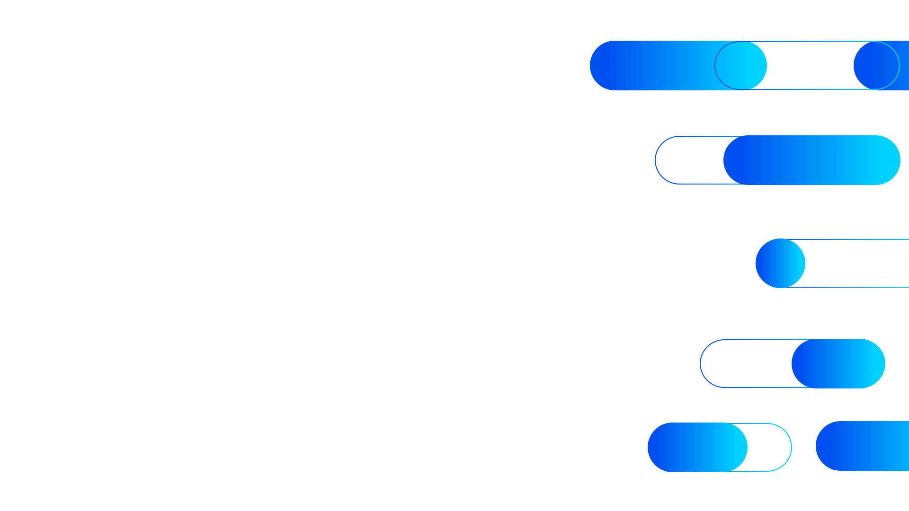

# the brand — Layout Patterns

> Every diagrammatic layout in the brand system, expressed as a reproducible recipe.
> Each pattern: USO · GRID · ESTRUTURA · HIERARQUIA · PILLS · ESPAÇAMENTO · RESPONSIVO · SNIPPET · ERRO COMUM.
> The HTML files in `templates/` are the runnable counterpart of every recipe here.

---

## Coordinate space and conventions

- **Slide canvas:** `1920 × 1080` (16:9). All slide measurements below are in canvas px.
- **Web canvas:** content max-width `1240px`, centered. Side gutters absorb the rest.
- **Logo on slides:** top-left, height `64px` (cover) or `54px` (content), `top: 60–130`, `left: 135`.
- **Default eyebrow on slides:** uppercase, 22px, `0.22em` tracked, white (on color) or `--brand-deep` (on light).

---

## 1. Cover slide

**USO** — the first slide of any deck. Identity-defining.

**GRID** — full-bleed, no columns. Logo top-left, headline anchored at vertical baseline `460px`, subhead at `700px`. Pill cluster bleeds off the right edge.

**ESTRUTURA (top → bottom)**
- **Logo (reversed)** — `assets/logo-white.svg`, `height: 64px`, position `top: 130px, left: 135px`.
- **Pill cluster** — `assets/pill-cluster.svg` in `on-color` paint mode (delicate white outlines + accent fade streaks). Fills the right ~700px and bleeds.
- **H1 headline** — `font-size: 128px`, `font-weight: 800`, `letter-spacing: -0.035em`, `line-height: 0.92`, color `#fff`. Width `980px`. Position `top: 460px, left: 135px`. Sentence case.
- **Subhead** — `font-size: 26px`, `font-weight: 400`, `line-height: 1.5`, color `rgba(255,255,255,0.92)`. Width `620px`. Position `top: 700px, left: 138px`.
- **Bottom-left mark** — small "the brand partner" mark or date strip at `bottom: 78px`. Optional.

**HIERARQUIA VISUAL** — Logo (orientation) → H1 (statement) → subhead (context) → pill cluster (texture/atmosphere). Reading is **diagonal: top-left → mid-left → top-right (texture)**.

**PILLS / DECORAÇÃO** — Right-edge cluster only. No left-side pills. Z-layer below content (`z-index: 0`); content `z-index: 1`.

**ESPAÇAMENTO** — Headline-to-subhead gap: `240px`. Margins follow the slide's "135px" left-rail (`--space-16` × 2 baseline).

**RESPONSIVO** — On 16:10 / 4:3 reflow, headline shrinks via clamp(56px, 8vw, 128px) and pill cluster scales proportionally.

**SNIPPET**
```html
<section class="slide cover" style="position:relative; width:1920px; height:1080px; background: linear-gradient(115deg, #0050f0 0%, #00d2ff 100%); color: #fff; overflow: hidden;">
  
  
  <h1 style="position:absolute; top:460px; left:135px; width:980px; font-size:128px; font-weight:800; letter-spacing:-0.035em; line-height:0.92;">
    Make confident credit decisions
  </h1>
  <p style="position:absolute; top:700px; left:138px; width:620px; font-size:26px; line-height:1.5; opacity:0.92;">
    Score and monitor 500M+ counterparties across 43 countries — through one platform.
  </p>
</section>
```

**ERRO COMUM** — Centering the headline horizontally. The cover is **left-anchored**; the pill cluster occupies the right.

---

## 2. Section opener (one per Category)

**USO** — section divider inside a deck, color-coded to the family. There are 5 variants: **blue (institutional)**, **credit (green)**, **supply (orange)**, **lead (magenta)**, **category-d (purple)**.

**GRID** — full-bleed family-gradient background. Number badge top-left of headline. Pill cluster bleeds right with `on-color` delicate paint, accent retuned to the family.

**ESTRUTURA**
- **Number badge** — outline pill, height `56px`, padding `0 28px 0 10px`. Inside: white `38px` circle holding the section number in `--brand-deep`, then white label text `22px`, `font-weight: 700`. Position `top: 360px, left: 135px`.
- **H2 headline** — `font-size: 76px`, `font-weight: 300` for the lead clause and `font-weight: 800` for the emphasis clause inside (use `<b>`). Width `1000px`, line-height `1.18`. Color `#fff`. Position `top: 450px, left: 135px`.
- **Pill cluster** — same geometry as cover, in `on-color` mode, with `--pill-accent` set to a light tint of the family's bright tone:
  - Blue: `#00d2ff` · Credit: `#00ff66` · Supply: `#ffd770` · Lead: `#ff5bb0` · Category D: `#7df0e0`

**HIERARQUIA VISUAL** — Number badge → H2 → cluster atmosphere. The number badge is the only chrome; everything else is type and texture.

**PILLS** — Right-edge cluster, on-color paint. Family-tuned `--pill-accent`.

**ESPAÇAMENTO** — Badge baseline `360px`, headline baseline `450px` (90px gap). Generous because the slide is sparse.

**SNIPPET**
```html
<section class="slide opener" style="position:relative; width:1920px; height:1080px; background: linear-gradient(115deg, var(--credit-deep), var(--credit-bright)); color: #fff; overflow: hidden; --pill-accent:#00ff66;">
  
  <div style="position:absolute; top:360px; left:135px;">
    <span style="display:inline-flex; align-items:center; gap:14px; height:56px; padding:0 28px 0 10px; border-radius:9999px; border:2px solid rgba(255,255,255,0.6); font-size:22px; font-weight:700;">
      <span style="width:38px; height:38px; border-radius:50%; background:#fff; color:var(--brand-deep, #0050f0); display:inline-flex; align-items:center; justify-content:center; font-weight:800; font-size:20px;">1</span>
      Category A
    </span>
  </div>
  <h2 style="position:absolute; top:450px; left:135px; width:1000px; font-size:76px; font-weight:300; line-height:1.18;">
    Score every counterparty <b style="font-weight:800;">in seconds, not days.</b>
  </h2>
</section>
```

**ERRO COMUM** — Using the family gradient on anything other than an opener / family-specific surface. Family gradients are categorical, not decorative.

---

## 3. Index / outline slide

**USO** — agenda / table of contents.

**GRID** — full-width. Eyebrow + title block top-left (`135, 130`); list anchored at `top: 430`.

**ESTRUTURA**
- **Logo mark top-right** — small, `height: 54px`, `top: 60, right: 64`.
- **Title** — "Outline Presentation" (or the deck title) in `font-size: 72px`, `font-weight: 800`, `letter-spacing: -0.02em`. The accent word (`Presentation`) wears the `.brand-text-gradient`.
- **Subhead** — `22px`, `line-height: 1.6`, `color: var(--brand-body)`, width `760px`, gap `16px` from title.
- **List items** — each row: `flex` row, `gap: 36px`, padding `30px 0`, bottom border `1px solid rgba(0,0,0,0.10)`. Number circle: `56px`, `border-radius: 50%`, `background: var(--brand-gradient)`, white text, `font-size: 26px`, `font-weight: 800`. Label: `font-size: 46px`, `font-weight: 500`, `color: var(--brand-title)`.

**HIERARQUIA VISUAL** — Title (anchor) → list rows (scanned). The numbered circles read like a beat track.

**PILLS / DECORAÇÃO** — None. Index is the calm slide.

**ESPAÇAMENTO** — Title to list: `300px` (top 130 → top 430). Between rows: `60px` (padding `30` × 2 each side of the border).

**SNIPPET**
```html
<section class="slide light" style="position:relative; width:1920px; height:1080px; background:#fafbfc;">
  
  <div style="position:absolute; top:130px; left:135px; width:1200px;">
    <div style="font-size:72px; font-weight:800; letter-spacing:-0.02em; color:var(--brand-title);">
      Outline <span class="brand-text-gradient">Presentation</span>
    </div>
    <p style="margin-top:16px; font-size:22px; line-height:1.6; color:var(--brand-body); width:760px;">
      Ut enim ad minima veniam, quis nostrum exercitationem.
    </p>
  </div>
  <ul style="position:absolute; top:430px; left:135px; width:1120px; list-style:none; margin:0; padding:0;">
    <li style="display:flex; align-items:center; gap:36px; padding:30px 0; border-bottom:1px solid rgba(0,0,0,0.10); font-size:46px; font-weight:500; color:var(--brand-title);">
      <span style="width:56px; height:56px; border-radius:50%; background:var(--brand-gradient); color:#fff; display:inline-flex; align-items:center; justify-content:center; font-size:26px; font-weight:800;">1</span>
      Glimpse of the product
    </li>
    <!-- repeat for items 2–4 -->
  </ul>
</section>
```

**ERRO COMUM** — Making the number circle pale (faded gradient). It must be a saturated D→B gradient — that's the only color hit on this slide.

---

## 4. Stat slide

**USO** — present one big number with a short caption.

**GRID** — left half: title + paragraph (`width: 620px`). Right half: stat label + giant gradient number + supporting copy.

**ESTRUTURA**
- **Left block** — title `60px / 800`, body paragraph `22px / 400 / 1.6`, color `--brand-body`.
- **Right block** — label uppercase (`30px / 800`, `tracking: 0.04em`), then giant gradient number (`200px / 800 / line-height 0.9 / letter-spacing -0.04em`) with `.brand-text-gradient`. Supporting copy `20px / 1.6 / var(--brand-body)` below.

**HIERARQUIA VISUAL** — Gradient number > title > copy. The number is the slide.

**PILLS** — None. The gradient on the number does the brand-color work.

**ESPAÇAMENTO** — Left block `top: 200, left: 135`. Right block `top: 300, left: 1020`. Internal gaps `24px` then `20px`.

**SNIPPET**
```html
<section class="slide light" style="position:relative; width:1920px; height:1080px; background:#fafbfc;">
  
  <div style="position:absolute; top:200px; left:135px; width:620px;">
    <div style="font-size:60px; font-weight:800; letter-spacing:-0.02em; color:var(--brand-title); line-height:1.05;">Coverage<br><span class="brand-text-gradient">across LATAM</span></div>
    <p style="margin-top:24px; font-size:22px; line-height:1.6; color:var(--brand-body);">the brand delivers commercial data across the entire Latin-American region.</p>
  </div>
  <div style="position:absolute; top:300px; left:1020px;">
    <div style="font-size:30px; font-weight:800; color:var(--brand-title); text-transform:uppercase; letter-spacing:0.04em;">Countries</div>
    <div class="brand-text-gradient" style="font-size:200px; font-weight:800; line-height:0.9; letter-spacing:-0.04em;">43</div>
    <p style="margin-top:20px; font-size:20px; line-height:1.6; color:var(--brand-body); width:620px;">Latin America and the Caribbean, including offshore territories.</p>
  </div>
</section>
```

**ERRO COMUM** — Using the gradient on every number on the slide. Only **one** stat per layout — the rest are color-flat.

---

## 5. Content + photo (right-side photo)

**USO** — narrative content slide with a supporting image. "The Problem" style.

**GRID** — left 60%, right 40% photo block. Photo runs full height (`1080px`) and bleeds the right edge.

**ESTRUTURA**
- **Title** — `96px / 800 / -0.03em / 0.98 line-height`. Two lines: stacked word + gradient word.
- **Body** — `24px / 400 / 1.6`, width `600px`, color `--brand-body`.
- **Photo slot** — right side `760×1080` block. Cover-fit, no border-radius (it's bleeding).

**HIERARQUIA VISUAL** — Title (anchor) → body (context) → photo (atmosphere). Reading is L→R, top-down.

**PILLS** — None on this layout. The photo is the visual weight.

**ESPAÇAMENTO** — Title at `top: 330, left: 135`. Body gap from title: `30px`.

**SNIPPET** — see `templates/photo-left.html` for the mirrored variant with brand-signature pills crossing the seam. The simple right-side photo variant inlines as above but is not shipped as a separate template (it is a strict subset of photo-left).

**ERRO COMUM** — Cropping the photo to a card with rounded corners. On this layout the photo bleeds.

---

## 6. Photo-left + text-right (with pill accents over the seam)

**USO** — same as #5 but reversed and decorated with horizontal pills that bleed across the photo/content seam — the brand's signature "pill on photo" treatment.

**GRID** — left 46% photo (`880×1080`), right 54% text. Three horizontal pills cross the seam at varying widths.

**ESTRUTURA**
- **Photo (left)** — `880×1080`, bleeding the left edge.
- **Pills (seam accents)** — three horizontal (0°) pills layered across the seam at `top: 120, 300, 880`. Each `40–46px` tall, varying widths (`170–220px`). Colors are Brand Bright / Deep / a blue mid-tone. Opacity `0.85–0.9`.
- **Title** — `104px / 800 / -0.03em / 0.96 line-height`, `top: 300, left: 980`, width `820px`. Two-line stacked + gradient word.
- **Lede** — `34px / 600 / 1.35 / var(--brand-title)`, width `760px`, gap `34px` from title.
- **Body** — `21px / 400 / 1.65 / var(--brand-body)`, width `760px`, gap `26px` from lede.

**HIERARQUIA VISUAL** — Photo (atmosphere) → pills (transition) → title → lede → body. Pills are the connective tissue.

**PILLS / DECORAÇÃO** — Three pills crossing the seam, **all 0°**, all uniform-tone (blue family only — not multi-color). Z-layer above photo, below text.

**ESPAÇAMENTO** — See exact coordinates above.

**SNIPPET**
```html
<section class="slide light" style="position:relative; width:1920px; height:1080px; background:#fafbfc;">
  <div style="position:absolute; left:0; top:0; width:880px; height:1080px; background:#cbd5e1 url('assets/placeholder-photo.jpg') center/cover no-repeat;"></div>
  <div style="position:absolute; left:760px; top:120px; width:200px; height:46px; border-radius:9999px; background:#00d2ff; opacity:.85;"></div>
  <div style="position:absolute; left:700px; top:300px; width:170px; height:42px; border-radius:9999px; background:#2a6fff; opacity:.9;"></div>
  <div style="position:absolute; left:740px; top:880px; width:220px; height:46px; border-radius:9999px; background:#0050f0; opacity:.9;"></div>
  <div style="position:absolute; left:980px; top:300px; width:820px;">
    <div style="font-size:104px; font-weight:800; letter-spacing:-0.03em; line-height:0.96; color:var(--brand-title);">
      The<br><span class="brand-text-gradient">Problem</span>
    </div>
    <p style="margin-top:34px; font-size:34px; font-weight:600; line-height:1.35; color:var(--brand-title); width:760px;">
      A counterparty's credit shifts in real time.
    </p>
    <p style="margin-top:26px; font-size:21px; line-height:1.65; color:var(--brand-body); width:760px;">
      Static annual reports lag the truth by 9–12 months.
    </p>
  </div>
</section>
```

**ERRO COMUM** — Mixing outline pills and filled pills with different colors on the seam. Must be one color family.

---

## 7. Feature grid (with the title | intro rule)

**USO** — show 3–4 features side by side.

**GRID** — top half: title left, vertical rule, intro right. Bottom half: 4-column equal grid of feature cards.

**ESTRUTURA**
- **Title** — `60px / 800 / -0.02em / 1.05`, left column, `width: 620px`. Accent word with `.brand-text-gradient`. Position `top: 175, left: 135`.
- **Vertical rule** — `2px` width, `200px` tall, gradient `linear-gradient(180deg, var(--brand-deep), rgba(0,80,240,0))`. Position `top: 170, left: 830`.
- **Intro paragraph** — `24px / 400 / 1.6 / var(--brand-body)`, width `880px`. Position `top: 185, left: 900`.
- **Feature cards (×4)** — equal columns, `gap: 28px`. Each card: white `#fff`, border `1px solid rgba(0,0,0,0.06)`, `border-radius: 24px`, padding `40px 34px`, shadow `0 20px 50px -34px rgba(0,80,240,0.3)`. Icon top (60×60), title `26px / 800 / var(--brand-title)` with `margin-top: 26px`, body `17px / 1.55 / var(--brand-body)` with `margin-top: 10px`.

**HIERARQUIA VISUAL** — Title block (anchor) → intro (context) → cards (parallel). Cards read horizontally.

**PILLS** — None on the slide variant; on the marketing-web variant a background pill drifts top-right at 6% opacity.

**ESPAÇAMENTO** — Title row `top: 175`, grid `top: 420`. Card padding `40 / 34` (vertical / horizontal).

**SNIPPET**
```html
<section class="slide light" style="position:relative; width:1920px; height:1080px; background:#fafbfc;">
  
  <div style="position:absolute; top:175px; left:135px; width:620px;">
    <div style="font-size:60px; font-weight:800; letter-spacing:-0.02em; line-height:1.05; color:var(--brand-title);">
      What makes <span class="brand-text-gradient">us special</span>
    </div>
  </div>
  <div style="position:absolute; top:170px; left:830px; width:2px; height:200px; background:linear-gradient(180deg, var(--brand-deep, #0050f0), rgba(0,80,240,0));"></div>
  <p style="position:absolute; top:185px; left:900px; width:880px; font-size:24px; line-height:1.6; color:var(--brand-body);">
    Built for the realities of Latin-American counterparty risk: regulatory complexity, multilingual data, and 43-country coverage.
  </p>
  <div style="position:absolute; top:420px; left:135px; right:140px; display:grid; grid-template-columns:repeat(4,1fr); gap:28px;">
    <article style="background:#fff; border:1px solid rgba(0,0,0,0.06); border-radius:24px; padding:40px 34px; box-shadow:0 20px 50px -34px rgba(0,80,240,0.3);">
      <span class="brand-icon icon-primary" style="width:60px; height:60px; display:block;"><!-- inline duotone SVG --></span>
      <h3 style="margin-top:26px; font-size:26px; font-weight:800; color:var(--brand-title);">Fast</h3>
      <p style="margin-top:10px; font-size:17px; line-height:1.55; color:var(--brand-body);">Sub-second scoring across 500M+ counterparties.</p>
    </article>
    <!-- ×3 more -->
  </div>
</section>
```

**ERRO COMUM** — Omitting the vertical rule. The `title | intro` rule is what differentiates this layout from a stock card grid.

---

## 8. Icon-pill list

**USO** — vertical list of attributes; each row is itself a full pill.

**GRID** — left 33%: large title + description. Right 67%: stacked column of pill rows.

**ESTRUTURA**
- **Title** — `88px / 800 / -0.03em / 1.0`, left column. Accent word with `.brand-text-gradient`. Position `top: 380, left: 135, width: 620`.
- **Description** — `22px / 1.6 / var(--brand-body)`, width `540`, gap `28px`.
- **Pill rows (×3–4)** — each: `display: flex`, `height: 116px`, padding `0 40px`, border-radius `9999px`, background `var(--brand-gradient)`, color `#fff`, gap `28px`. Icon `52×52` themed `.icon-on-dark`. Inline: row title `26px / 800`, supporting copy `17px / 0.9 opacity`.

**HIERARQUIA VISUAL** — Title (anchor) → list rows (scanned). Each pill row is a complete card; reading is top-down.

**PILLS** — The rows ARE the pills. No additional decorative pills.

**ESPAÇAMENTO** — Row column at `top: 300, right: 140, width: 760`. Gap between rows: `34px`.

**SNIPPET**
```html
<section class="slide light" style="position:relative; width:1920px; height:1080px; background:#fafbfc;">
  
  <div style="position:absolute; top:380px; left:135px; width:620px;">
    <div style="font-size:88px; font-weight:800; letter-spacing:-0.03em; line-height:1.0; color:var(--brand-title);">
      Things<br>that <span class="brand-text-gradient">matter</span>
    </div>
    <p style="margin-top:28px; font-size:22px; line-height:1.6; color:var(--brand-body); width:540px;">Three properties every Brand insights workflow inherits.</p>
  </div>
  <div style="position:absolute; right:140px; top:300px; width:760px; display:flex; flex-direction:column; gap:34px;">
    <div style="display:flex; align-items:center; gap:28px; height:116px; padding:0 40px; border-radius:9999px; background:var(--brand-gradient); color:#fff;">
      <span class="brand-icon icon-on-dark" style="width:52px; height:52px;"><!-- inline duotone SVG --></span>
      <div>
        <div style="font-size:26px; font-weight:800;">Flexibility</div>
        <div style="font-size:17px; opacity:0.9;">Drop-in modules for credit, supply, lead, and category-d workflows.</div>
      </div>
    </div>
    <!-- ×2 more -->
  </div>
</section>
```

**ERRO COMUM** — Setting `border-radius` smaller than `height / 2` on a row. The rows MUST be full pills, not rounded cards.

---

## 9. Two-column text + stat

**USO** — text-heavy layout with one stat anchor. The brand's typographic showcase.

**GRID** — top: title block. Bottom row: two equal columns. Left col: prose. Right col: stat (label + giant gradient number + supporting copy).

**ESTRUTURA**
- **Title block** — `84px / 800 / -0.025em / 0.98`, width `1000px`. Title plus gradient accent. Lede `30px / 700 / 1.4 / var(--brand-body)`, width `760px`, gap `26px`. Position `top: 120, left: 135`.
- **Left column (prose)** — `24px / 400 / 1.7 / var(--brand-body)`, width `840px`. Position `top: 560, left: 135`.
- **Right column (stat)** — Label `42px / 800 / var(--brand-title)`. Number `158px / 800 / 0.9 / -0.04em` with `.brand-text-gradient`, `margin-top: 6px`. Supporting copy `22px / 1.6 / var(--brand-body)`, `margin-top: 28px`. Position `top: 560, left: 1090, width: 700`.

**HIERARQUIA VISUAL** — Title (anchor) → prose-vs-stat (parallel reading). The stat is visually heavier; the prose carries the meaning.

**PILLS** — None.

**ESPAÇAMENTO** — Title to body row: `~150px` (top 120 → top 560 with body in between). Column gap implied by `left: 135` vs `left: 1090`.

**SNIPPET**
```html
<section class="slide light" style="position:relative; width:1920px; height:1080px; background:#fafbfc;">
  
  <div style="position:absolute; top:120px; left:135px; width:1000px;">
    <div style="font-size:84px; font-weight:800; letter-spacing:-0.025em; line-height:0.98; color:var(--brand-title);">
      Outline<br><span class="brand-text-gradient">Presentation</span>
    </div>
    <p style="margin-top:26px; font-size:30px; font-weight:700; line-height:1.4; color:var(--brand-body); width:760px;">A field-tested approach to counterparty intelligence.</p>
  </div>
  <p style="position:absolute; top:560px; left:135px; width:840px; font-size:24px; line-height:1.7; color:var(--brand-body);">
    Two decades of operating across LATAM gives Brand a perspective no global provider can match.
  </p>
  <div style="position:absolute; top:560px; left:1090px; width:700px;">
    <div style="font-size:42px; font-weight:800; color:var(--brand-title); line-height:1;">Coverage</div>
    <div class="brand-text-gradient" style="font-size:158px; font-weight:800; line-height:0.9; letter-spacing:-0.04em; margin-top:6px;">500M+</div>
    <p style="margin-top:28px; font-size:22px; line-height:1.6; color:var(--brand-body);">Companies tracked across the global the brand Worldwide Network.</p>
  </div>
</section>
```

**ERRO COMUM** — Letting prose column width balloon past `~840px`. Past that, line length exceeds the readable ceiling.

---

## 10. Marketing hero (web)

**USO** — landing-page hero band for the public the brand site.

**GRID** — `max-width: 1240px` centered, padded `var(--space-24)` top + bottom. Content on the left, pill cluster on the right.

**ESTRUTURA**
- **Eyebrow** — `11px / 700 / 0.22em / uppercase`, color `--brand-deep`.
- **Headline** — display scale (`clamp(48px, 8vw, 108px)`), weight `800`, `letter-spacing: -0.035em`, line-height `0.95`, color `--brand-title`. Last word/phrase in `.brand-text-gradient`.
- **Lede** — `22px / 300 (Light) / 1.35 / var(--brand-body)`, max-width `560px`, `margin-top: 24px`.
- **CTA row** — primary button (filled gradient pill) + ghost link. Pills `r=h/2`, height `56px`.
- **Pill cluster** — right column, ~600px wide, scaled-down version of the signature cluster (`on-light` paint, per-pill D→B gradient fills + 2px gradient rings).

**HIERARQUIA VISUAL** — Eyebrow → headline → lede → CTAs. Right side adds atmosphere only.

**PILLS** — Right-side cluster, on-light paint.

**ESPAÇAMENTO** — Section padding: `--space-24` (96px) top + bottom. Headline-to-lede: `24px`. Lede-to-CTAs: `40px`.

**SNIPPET**
```html
<section style="background:#fafbfc; padding: var(--space-24) var(--space-8);">
  <div style="max-width: var(--content-max); margin: 0 auto; display:grid; grid-template-columns: 1.1fr 1fr; gap: var(--space-16); align-items:center;">
    <div>
      <span class="eyebrow">the brand</span>
      <h1 style="margin-top: var(--space-4); font-size: clamp(48px, 8vw, 88px); font-weight:800; letter-spacing:-0.035em; line-height:0.95; color:var(--brand-title);">
        Make confident <span class="brand-text-gradient">counterparty decisions</span>
      </h1>
      <p style="margin-top: var(--space-6); font-size:22px; font-weight:300; line-height:1.35; color:var(--brand-body); max-width: 560px;">
        Score, monitor, and grow with 500M+ companies — across 43 countries in Latin America and the Caribbean.
      </p>
      <div style="margin-top: var(--space-10); display:flex; gap: var(--space-4); align-items:center;">
        <a href="#" style="display:inline-flex; align-items:center; padding:0 28px; height:56px; border-radius:9999px; background:var(--brand-gradient); color:#fff; font-weight:700; text-decoration:none;">Request a demo</a>
        <a href="#" style="color:var(--brand-deep); font-weight:700;">See the platform →</a>
      </div>
    </div>
    <div style="position:relative; aspect-ratio: 1/0.85;">
      
    </div>
  </div>
</section>
```

**ERRO COMUM** — Stretching the pill cluster to full bleed on web. On marketing pages it's a containment element on the right; on slides it bleeds.

---

## 11. Solution grid (web)

**USO** — show all four Categories on one row.

**GRID** — 4 equal columns, gap `var(--space-6)` (24px). Card height auto. Within each card: family icon (top), family name (h3), short description, "Learn more →" link.

**ESTRUTURA per card**
- White background `#fff`, border `1px solid rgba(0,0,0,0.06)`, border-radius `var(--radius-lg)` (16px), padding `var(--space-8)` (32px), shadow `var(--shadow-md)`.
- **Icon container** — `64×64`, `border-radius: 22% of 64 = 14px`. Variant is per family (Bright fill for Credit + Lead; Deep fill for Supply + Category D — see BRAND_RULES §4).
- **Family name** — `h3` size, weight 800, color `--brand-title`.
- **Description** — body size, `--brand-body`, `max-width: 26ch`.
- **Link** — `--brand-deep`, weight 700, with `→` glyph.

**HIERARQUIA VISUAL** — Icon (color anchor) → name → description → link.

**PILLS** — None inside cards. The grid sits on the standard white-page background and may inherit a far-edge floating background pill.

**ESPAÇAMENTO** — Card padding `--space-8`. Hover: lift `-2px`, swap shadow to `--shadow-glow`.

**SNIPPET**
```html
<div style="display:grid; grid-template-columns: repeat(4, 1fr); gap: var(--space-6);">
  <article style="background:#fff; border:1px solid rgba(0,0,0,0.06); border-radius: var(--radius-lg); padding: var(--space-8); box-shadow: var(--shadow-md);">
    <div class="icon-box icon-box--colored" style="--box-fill: var(--credit-bright); width:64px; height:64px; box-shadow: var(--shadow-solution);">
      <!-- inlined category-a.svg, 40×40, both tones white -->
    </div>
    <h3 style="margin-top: var(--space-6); color: var(--brand-title);">Category A</h3>
    <p style="margin-top: var(--space-3);">Score and monitor counterparties in real time.</p>
    <a href="#" style="display:inline-block; margin-top: var(--space-4); color: var(--brand-deep); font-weight:700; text-decoration:none;">Learn more →</a>
  </article>
  <!-- ×3 more, one per family -->
</div>
```

**ERRO COMUM** — Applying a different icon-box rule per family (e.g., all Bright). Credit + Lead use Bright fills; Supply + Category D use Deep fills.

---

## 12. Stat strip (web)

**USO** — proof-points band beneath the hero. Single row of 3–4 stats.

**GRID** — `display: flex`, `justify-content: space-between`, padding `--space-16` top + bottom on the band. Each stat: label (eyebrow style), giant gradient number, supporting copy.

**ESTRUTURA**
- Each stat block: `flex: 1`, padding `var(--space-6)`, optional vertical rule between blocks (1px × 80px height, color `rgba(0,80,240,0.15)`).
- **Number** — `clamp(56px, 5vw, 88px) / 800 / -0.04em`, `.brand-text-gradient`.
- **Label** — `eyebrow` style.
- **Copy** — small body.

**SNIPPET**
```html
<section style="background:#fafbfc; padding: var(--space-16) var(--space-8); border-block: 1px solid rgba(0,0,0,0.06);">
  <div style="max-width: var(--content-max); margin: 0 auto; display:flex; gap: var(--space-12);">
    <div style="flex:1;">
      <span class="eyebrow">Coverage</span>
      <div class="brand-text-gradient" style="font-size: clamp(56px, 5vw, 88px); font-weight:800; letter-spacing:-0.04em; line-height:1;">43</div>
      <p>Countries across Latin America and the Caribbean.</p>
    </div>
    <div style="flex:1;">
      <span class="eyebrow">Customers</span>
      <div class="brand-text-gradient" style="font-size: clamp(56px, 5vw, 88px); font-weight:800; letter-spacing:-0.04em; line-height:1;">20,000+</div>
      <p>Active organizations served region-wide.</p>
    </div>
    <div style="flex:1;">
      <span class="eyebrow">Network</span>
      <div class="brand-text-gradient" style="font-size: clamp(56px, 5vw, 88px); font-weight:800; letter-spacing:-0.04em; line-height:1;">500M+</div>
      <p>Companies in the global the brand graph.</p>
    </div>
  </div>
</section>
```

**ERRO COMUM** — Including more than 4 stats. The brand limits the strip to 3–4 to keep each number breathing.

---

## 13. Feature showcase (web)

**USO** — long-form section with a left-column anchor (image / illustration / icon set) and a right-column list of mini features.

**GRID** — 2 columns, `1.2fr 1fr`, gap `var(--space-16)`. Right column stacks 4–6 row items.

**ESTRUTURA**
- **Left** — visual: image-slot, screenshot, or icon stack. Full-height of column. Optional pill float behind.
- **Right** — vertical list. Each row: icon (`24×24`), title `h3-size / 700`, body. Rows separated by `--space-8`.

**SNIPPET** — see `templates/feature-grid.html` for the unified pattern combined with the 4-card grid.

**ERRO COMUM** — Forgetting to anchor the eyebrow above the section. Section heads always carry an eyebrow above them.

---

## 14. Footer mega-band (web)

**USO** — full-bleed footer band with the brand wordmark and links.

**GRID** — full-bleed background `var(--brand-gradient)` (90°). Content `max-width: var(--content-max)`, centered, padding `var(--space-20)` top + `var(--space-12)` bottom.

**ESTRUTURA**
- **Top row** — large headline `48–72px / 800 / white`, e.g., "Data-driven relationships, designed." Subhead `22px / 300 / white 0.9 opacity`.
- **Mid row** — 4 link columns (Solutions, Company, Resources, Legal). Column headers `eyebrow` style in white. Links `body size / weight 400 / white 0.9 opacity`. Gap `var(--space-12)`.
- **Bottom row** — logo-white + small copyright line.

**PILLS** — One floating pill cluster low-right, `on-color` delicate paint at low opacity.

**SNIPPET**
```html
<footer style="background: var(--brand-gradient); color:#fff;">
  <div style="max-width: var(--content-max); margin:0 auto; padding: var(--space-20) var(--space-8) var(--space-12);">
    <h2 style="font-size: clamp(36px, 5vw, 72px); font-weight:800; letter-spacing:-0.025em; line-height:1.05; color:#fff; max-width: 720px;">
      Data-driven relationships, designed.
    </h2>
    <p style="margin-top: var(--space-6); font-size: 22px; font-weight:300; max-width:560px; opacity:0.9;">
      The exclusive Latin-American partner of the the brand Worldwide Network.
    </p>
    <!-- column row, bottom row… -->
  </div>
</footer>
```

**ERRO COMUM** — Reversing gradient direction (B→D). The footer is always Deep on the left, Bright on the right.

---

## 15. SaaS dashboard (app)

**USO** — primary authenticated app surface for the Risk Insights platform.

**GRID** — fixed left sidebar (`240px`) + top bar (`64px`) + content grid (4-col KPI cards + 2-col panels below).

**ESTRUTURA**
- **Sidebar** (`240×viewport`) — dark navy `--surface-ink`. Logo top, nav list (icon + label rows), profile bottom. Active item: brand-outline border-left + `rgba(0,210,255,0.12)` bg.
- **TopBar** (`viewport × 64`) — white, hairline bottom border. Page title left, search center, user menu right.
- **Content area** — padding `var(--space-8)`, max-width `1440px`. 
  - **KPI row** — `grid-template-columns: repeat(4, 1fr); gap: var(--space-6)`. KPI card (see COMPONENTS.md).
  - **Below** — 2-column: left = company table; right = risk gauge + alert list.

**HIERARQUIA VISUAL** — Page title → KPIs (parallel) → table (primary) → alerts (secondary).

**PILLS** — None inside the app. Pills are a marketing-surface motif.

**ESPAÇAMENTO** — Card padding `var(--space-6)` (24px). Gap between rows `var(--space-8)` (32px). Sidebar item height `44px`.

**RESPONSIVO** — Sidebar collapses to icon-only at < 1024px. KPI grid → 2 cols, then 1 col.

**SNIPPET** — see `templates/dashboard.html`.

**ERRO COMUM** — Putting pill decorations in the app surface. Keep app chrome free of marketing motifs.

---

## 16. Company detail (app)

**USO** — detail view for a single counterparty record. The "drill-in" screen of the risk app.

**GRID** — same shell as dashboard. Content layout:
- **Header band** — company name (h1 size), country flag + tax-id row (eyebrow style), action buttons right.
- **Risk summary** — `risk gauge` left, score breakdown (4 small KPI cards) right.
- **Tabbed sections** — Overview · Financials · Suppliers · Alerts · Documents.
- **Body** — table of related entities + recent alerts column.

**ESTRUTURA**
- Header: padding `var(--space-8) var(--space-8) var(--space-6)`. Company name `h1 / 800 / -0.02em`. Sub-row `eyebrow + middle-dot · separator + middle-dot ·`.
- Action buttons: pill primary + ghost pill.

**HIERARQUIA VISUAL** — Company name (anchor) → risk gauge (verdict) → financial summary → drill-in tables.

**PILLS** — None.

**SNIPPET** — see `templates/company-detail.html`.

**ERRO COMUM** — Using a family color for the page chrome because the company is "in credit." The page chrome stays neutral; family color only flags the section that's about that family.

---

## 17. Sign-in / auth

**USO** — entry screen for the SaaS app.

**GRID** — 2 columns at desktop: left 50% white card with form; right 50% blue D→B gradient with pill cluster atmosphere + brand statement.

**ESTRUTURA**
- **Left (form)** — Logo top, headline `Sign in to your dashboard`, fields (email, password) with `var(--border-default)`, primary pill button "Sign in" full-width, "Forgot password? · Create account" links below.
- **Right (brand)** — gradient background, large brand statement, pill cluster bleeding right.

**ESPAÇAMENTO** — Form column max-width `480px`, centered. Padding `var(--space-16)`. Field height `48px`, gap `var(--space-4)`.

**SNIPPET** — see `templates/sign-in.html`.

**ERRO COMUM** — Centering the form on the gradient. Form is on white; gradient is the **partner column**, not the background.

---

## A note on responsive collapse

All web layouts (10–14) collapse using the same logic:
- **≥1240px** — full layout as specified.
- **1024–1239px** — content fills viewport with `var(--space-8)` side gutters; right-column elements (pill clusters, hero images) shrink to maintain ratio.
- **768–1023px** — 2-column grids → 1 column; 4-column grids → 2 columns; sidebar in apps collapses to icon rail.
- **<768px** — single column everything; hero headline scales via clamp; nav becomes off-canvas drawer.

All slide layouts (1–9) are fixed at `1920×1080` and scale via the deck stage — they never reflow.
